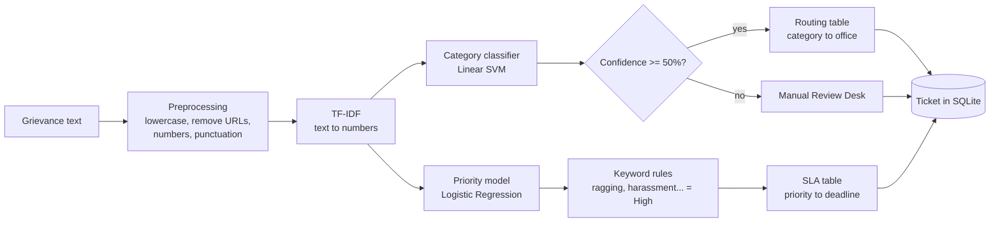

# College Grievance Portal: Smart Complaint Classification and Routing System

**Live demo:** [https://college-grievance-app-edmhv6dyxtqyg2pffwghiq.streamlit.app/](https://college-grievance-app-edmhv6dyxtqyg2pffwghiq.streamlit.app/)

A web portal where a student types a grievance in plain English, and an AI system decides what it is
about, how urgent it is, and which college office should handle it. A machine learning model
(TF-IDF + Linear SVM) classifies the grievance into one of six categories, a second model plus
safety keyword rules assigns a High / Medium / Low priority, and a routing table sends it to the right
office (Warden, Exam Cell, Accounts, HOD, IT Cell or Anti-Ragging Committee) with a response
deadline. Every grievance is saved as a ticket in SQLite and shown on an admin dashboard.

## Why a college grievance portal?

Colleges are required to have a grievance redressal mechanism and an anti-ragging committee, but
grievances often arrive as one long, mixed-up email or form that someone must read and forward by
hand. Urgent cases like ragging or food poisoning can wait in the same queue as a request for a
new mess menu. This system reads each grievance instantly, sends it to the right office, and
makes sure safety issues get a 4-hour deadline.

## Categories and routing

| Category | Routed to | Example grievance |
|---|---|---|
| Hostel & Mess | Hostel Warden Office | "The mess food was stale and many students fell sick" |
| Exams & Results | Examination Cell | "My hall ticket is not generated and the exam is tomorrow" |
| Fees & Scholarships | Accounts Office | "I paid my semester fees twice and it is not refunded" |
| Academics & Faculty | Head of Department | "The syllabus is not completed and exams are near" |
| IT & Wi-Fi | IT Services Cell | "The hostel wifi has not worked for a week" |
| Ragging & Harassment | Anti-Ragging Committee | "Seniors are ragging me in the hostel every night" |

| Priority | Response deadline |
|---|---|
| High | 4 hours |
| Medium | 24 hours |
| Low | 72 hours |

If the model's confidence is below 50%, the grievance goes to the **Manual Review Desk** instead.
The student name is optional, so ragging and harassment can be reported anonymously.

## System flow



Plain-text version:

```
Grievance -> Preprocessing -> TF-IDF -> Classifier -> Priority -> Routing -> Ticket
```

## The app

| Section | Page | What you can do |
|---|---|---|
| Student | **Submit Grievance** | Type a grievance (or pick an example) and get a ticket showing category, priority, office, deadline, AI confidence and *why* the AI chose that category |
| Administration | **Dashboard** | KPI tiles (total, open, high priority, overdue), charts per category and office, a searchable and filterable ticket table, CSV export, and status updates |
| Administration | **Database** | Look inside the SQLite database: browse the raw table, see the schema, run read-only SQL queries, download the `.db` file, load demo data |
| AI Models | **Model Explorer** | See every saved model and its settings, compare performance, see the words each model learned, test all models side by side, and view the pipeline diagram |

### Seeing the database

Tickets are stored in **`complaints.db`** (SQLite), created automatically in the project folder.

- **In the app:** open **Database**. The *SQL console* tab runs your own `SELECT` queries on a
  read-only connection, so a mistake like `DELETE FROM tickets` is blocked by SQLite itself.
- **Outside the app:** open `complaints.db` in the free [DB Browser for SQLite](https://sqlitebrowser.org).

### Seeing the trained models

`python -m src.train` saves everything to **`models/`**:

| File | What it is |
|---|---|
| `vectorizer.joblib` | TF-IDF vectorizer: the learned vocabulary that turns text into numbers |
| `category_model.joblib` | Category model **in use**: Linear SVM wrapped in `CalibratedClassifierCV` |
| `priority_model.joblib` | Priority model **in use**: Logistic Regression |
| `candidates/*.joblib` | All three compared models (Naive Bayes, Logistic Regression, Linear SVM) |
| `model_info.json` | Readable description: training date, settings, accuracy, dataset size |

Open **Model Explorer** in the app to inspect them, or load one in Python:

```python
import joblib
model = joblib.load("models/category_model.joblib")
print(model.classes_)
```

## Project structure

```
complaint-router/
├── app.py                     App setup and sidebar navigation
├── ui/                        One file per page
│   ├── submit_page.py         Student: submit a grievance
│   ├── dashboard_page.py      Admin: tickets, KPIs, filters, status updates
│   ├── database_page.py       Admin: look inside the database
│   ├── models_page.py         AI: model explorer
│   └── common.py              Shared helpers (headers, badges, charts)
├── src/
│   ├── preprocess.py          clean_text()
│   ├── train.py               Trains and compares models, saves models/ and reports/
│   ├── predict.py             analyze_complaint(): the full pipeline for one grievance
│   ├── priority.py            ML priority + urgent/safety keyword rules
│   ├── router.py              Office and SLA tables, route()
│   ├── database.py            SQLite ticket storage and read-only queries
│   ├── explain.py             Which words each model learned / used for a prediction
│   ├── clock.py               India time for all timestamps (cloud servers use UTC)
│   └── demo_data.py           Sample tickets for demos
├── data/generate_dataset.py   Builds the synthetic dataset -> data/complaints.csv
├── models/                    Trained models (see above)
├── reports/                   metrics.json, charts, classification report
├── assets/                    Logo
├── .streamlit/config.toml     Theme (indigo) and app settings
└── tests/                     93 pytest tests
```

## Setup and run

Open a terminal **inside the `complaint-router` folder** (Python 3.10 or newer), then run:

```bash
pip install -r requirements.txt
python data/generate_dataset.py
python -m src.train
pytest
streamlit run app.py
```

The app opens at http://localhost:8501. The dataset and trained models are already included, so
the middle commands are only needed if you want to regenerate them.

**If `pip`, `pytest` or `streamlit` says "command not found" or picks the wrong Python** (common on
Windows with several Python versions installed), use the `python -m` form:

```bash
python -m pip install -r requirements.txt
python -m pytest
python -m streamlit run app.py
```

## Deployment (Streamlit Community Cloud, free)

1. Push this folder to a public GitHub repository (the trained models in `models/` must be included).
2. Go to [share.streamlit.io](https://share.streamlit.io), sign in with GitHub and click **Create app**.
3. Choose the repository, branch `main` and main file `app.py`.
4. Open **Advanced settings** and choose **Python 3.12** (or 3.13).
5. Click **Deploy**. After a few minutes the app is live at a `*.streamlit.app` address.

`requirements.txt` pins exact versions because the saved models only load with the same
scikit-learn version (1.9.1) that trained them.

**Note:** on the free cloud the `complaints.db` file is temporary and resets when the app restarts
or sleeps. Use **Load demo tickets** (Dashboard or Database page) to fill it before a demo. For
permanent storage you would move to a hosted database such as PostgreSQL.

## AI concepts used

**Text preprocessing.** Raw text is messy: capital letters, links, numbers and punctuation. We
lowercase everything and strip the noise with regular expressions so that "HOSTEL!!" and "hostel"
count as the same word.

**TF-IDF (Term Frequency – Inverse Document Frequency).** Turns text into numbers a model can use.
A word gets a high score if it appears often in this grievance (TF) but rarely across all grievances
(IDF), so words like "ragging" or "scholarship" matter more than common words like "college". We also
use bigrams (two-word phrases like "hall ticket") and remove English stop words like "the" and "is".

**Naive Bayes.** A probabilistic classifier based on Bayes' theorem. It learns how likely each word is
in each category and multiplies these probabilities together, "naively" assuming words are
independent. It is very fast and a strong baseline for text.

**Logistic Regression.** Learns a weight for every word per category, adds up the weights for the words
in a grievance and turns the total into a probability with the softmax function. Positive weights
push toward a category, negative weights push away.

**Support Vector Machine (Linear SVM).** Finds the boundary (hyperplane) that separates categories with
the widest possible margin. A wide margin makes it robust to noisy text. Plain SVMs give no
probabilities, so we wrap the winner in `CalibratedClassifierCV` to get a confidence score.

**Train/test split.** We train on 80% of the data and keep 20% hidden for the final exam. Testing on
unseen data tells us how the model will do on new grievances. `stratify` keeps the same category mix
in both parts.

**Cross-validation.** The training set is split into 5 parts. The model trains on 4 and tests on the
5th, five times in rotation. The average score is more reliable than a single split, and a small
standard deviation shows the model is stable.

**Confusion matrix.** A table of true category (rows) vs predicted category (columns). The diagonal
shows correct predictions, and any off-diagonal cell shows which categories get confused. In our
results the most common mix-up is *Ragging & Harassment* predicted as *Academics & Faculty*, because
grievances like "a faculty member insulted me" mention teachers. See `reports/confusion_matrix.png`.

**Precision, recall and F1.** *Precision*: of the grievances we labelled "Hostel", how many really were.
*Recall*: of all real Hostel grievances, how many did we catch. *F1* is the harmonic mean of the two.
"Macro" averages them over the six categories equally. We pick the best model by macro F1. For a
category like Ragging, recall matters most, because a missed case is worse than a false alarm.

**Rule-based routing.** Once the category and priority are known, plain Python dictionaries decide the
office and the deadline (SLA). Rules are transparent and easy to change without retraining. Rules
also act as a safety net: words like "ragging", "harassment", "unsafe" or "food poisoning" always
force High priority, whatever the model says.

**Confidence threshold.** The model's highest class probability is its confidence. If it is below 50%,
the model is unsure, so the ticket goes to a human at the Manual Review Desk instead of possibly the
wrong office.

## Results

From `python -m src.train` (2400 grievances: 1920 train, 480 test):

| Model | Accuracy | Precision (macro) | Recall (macro) | F1 (macro) | 5-fold CV accuracy |
|---|---|---|---|---|---|
| Naive Bayes | 0.9083 | 0.9102 | 0.9084 | 0.9086 | 0.9198 ± 0.0089 |
| Logistic Regression | 0.8979 | 0.9005 | 0.8980 | 0.8984 | 0.9161 ± 0.0173 |
| **Linear SVM (winner)** | **0.9125** | **0.9130** | **0.9126** | **0.9126** | 0.9214 ± 0.0154 |

- Saved category model (calibrated Linear SVM) test accuracy: **91.25%**
- Priority model (Logistic Regression) test accuracy: **88.96%**

Per-category results for the winning model:

```
                      precision    recall  f1-score   support

 Academics & Faculty     0.8642    0.8750    0.8696        80
     Exams & Results     0.9012    0.9125    0.9068        80
 Fees & Scholarships     0.9610    0.9367    0.9487        79
       Hostel & Mess     0.8929    0.9375    0.9146        80
          IT & Wi-Fi     0.9487    0.9250    0.9367        80
Ragging & Harassment     0.9114    0.8889    0.9000        81
```

**Why not 100%?** Clean template sentences are too easy: an early version of the generator scored
about 98.5%, which is unrealistic. The generator therefore adds words shared across categories
("hostel", "portal", "fees", "office"), grievances that mention two topics, vague one-liners
("hostel problem again"), typos, ALL CAPS rows and 2% label noise (in real data, people do not always
agree on a label). The remaining errors are mostly these hard cases.

## Limitations

- **Synthetic data.** The grievances are generated from templates, so real student text will be more
  varied and accuracy will likely be lower.
- **English only.** Students often write in Hinglish or regional languages, which this model does not
  understand.
- **Single label.** Each grievance gets one category, even if it covers two problems (for example a
  hostel wifi problem could be Hostel or IT).
- **Over-confidence on common words.** "I am not happy with this college" is sent to IT & Wi-Fi with
  high confidence, because the word "college" mostly appears in IT phrases like "college wifi". The
  model learns word patterns, not meaning.
- **Keyword rules are simple.** "not urgent" still contains "urgent" and gets escalated.

## Future scope

- Train on real, anonymised grievances from the college's existing complaint records.
- Support Hindi, Hinglish and regional languages with multilingual models.
- Deep learning models such as BERT to understand context and negation.
- Email or SMS alerts to the warden, HOD or anti-ragging committee when a High priority ticket arrives,
  and reminders when an SLA deadline is close.
- Student login so students can track the status of their own grievances.
- A hosted database (PostgreSQL) so tickets survive cloud restarts.
- Multi-label classification so one grievance can go to two offices.
